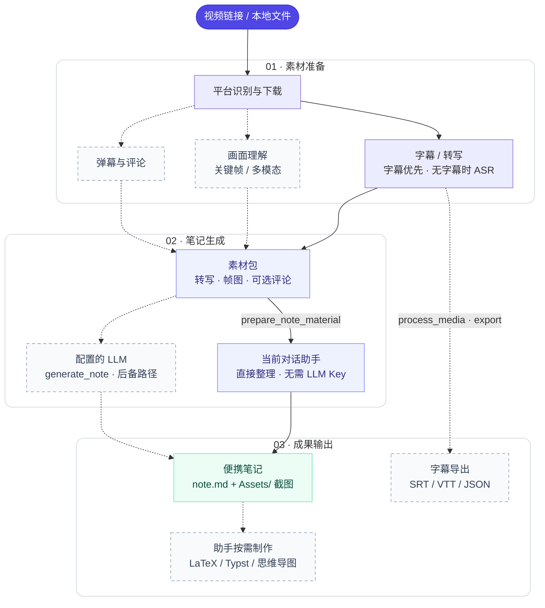
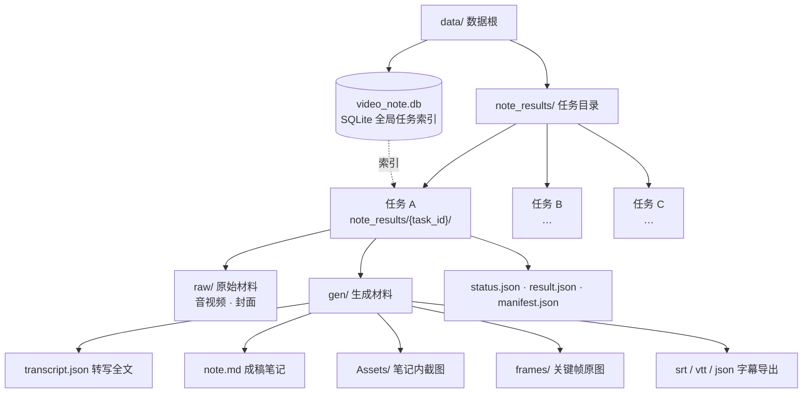

<p align="center"></p>
<h1 align="center">VideoNote-Mcp</h1>
<p align="center"><em>视频链接 → 多格式笔记</em><br/>一条链接 → 一篇笔记 · 端到端或解耦，任意组合</p>
<p align="center"><strong>中文</strong> | <a href="./README_EN.md">English</a></p>
<p align="center">
  <a href="#快速开始">快速开始</a> •
  <a href="#文档">文档</a> •
  <a href="#真实案例">真实案例</a> •
  <a href="#流水线地图">流水线地图</a> •
  <a href="#任务管理">任务管理</a> •
  <a href="#最佳实践">最佳实践</a> •
  <a href="#如何贡献">如何贡献</a>
</p>

---

VideoNote-Mcp 把「视频链接 → 多格式笔记」整条流水线打包成 **MCP Server**：给它一个链接，自动完成下载 → 语音转写 → 画面理解 → 弹幕/评论，并生成文字稿或笔记。

仓库：[HuangYincan/VideoNote-MCP](https://github.com/HuangYincan/VideoNote-MCP)。

既可端到端使用（一条链接 → 一篇笔记），也可解耦：生成、素材、任务、媒体处理等工具按需取用。无需启动任何后端服务。

<p align="center">
  <a href="https://github.com/HuangYincan/VideoNote-MCP"></a>
  <a href="LICENSE"></a>
  <a></a>
  <a></a>
  <a href="https://glama.ai/mcp/servers/HuangYincan/VideoNote-MCP"></a>
</p>

---

## 快速开始

**自动安装：检测客户端、推荐转写方案，再注册 MCP。**

Windows / Linux / macOS 均使用 Python 安装向导。先安装 [uv](https://docs.astral.sh/uv/getting-started/installation/)。

```bash
# 当前源码（先克隆仓库并进入目录）
uv run --frozen videonote install

# 发布包含此功能的新版本后，三个系统都可以直接使用
uvx videonote@latest install
```

> 此次新增的 `install` 子命令需先发布，既有 PyPI 版本不会因源码更新自动获得它。

向导支持 Claude Code、Codex、Claude Desktop、Cursor、OpenCode、Pi、Grok Build、Gemini CLI、Kiro、VS Code、GitHub Copilot CLI。默认显示通过 CLI / 配置检测到的候选，其他平台可从“手动选择其他平台”进入；用方向键移动、空格多选、回车确认，左键取消。Pi 需要支持原生 MCP 的版本，安装前检查 CLI 能力。安装与 setup 统一使用彩色终端主题：当前选项高亮，字段、状态和说明分色；支持 `NO_COLOR`，重定向输出使用纯文本。多套历史配置的路径只展示一次，选择菜单使用短摘要，MLX 设备显示为 Apple GPU。转写方案和模型尺寸也用菜单选择。Apple Silicon 推荐 MLX；NVIDIA GPU 与匹配运行库就绪时推荐 CUDA；其余推荐 CPU。已有转写设置默认保留；选择前列出引擎、模型、设备、预处理、说话人分离及配置来源和路径。向导识别旧 Agent 注册与历史配置目录，多套配置时先选择；“保留”不再重新询问模型尺寸。可选安装依赖和下载模型。配置和 MCP 使用相同运行环境。

安装后可在 `videonote setup` 的 **① Agent 客户端 → 启用的平台（多选）** 中调整：例如取消 Claude Code、只勾选 Codex，确认后即可禁用 Claude Code 中的 VideoNote。原注册可恢复，其他 MCP 和 Agent 设置会保留；也可在此安装 / 更新平台。**卸载 VideoNote 注册（多选）**会删除所选平台的用户级注册及禁用恢复存档，保留程序、模型和笔记，改动前创建备份。启用 / 禁用显示的是配置状态，已有会话需重启或重连；插件、项目配置及兼容导入请在 Agent 中管理。

```bash
# 以下示例使用当前源码；发布后可将前缀换成 uvx videonote@latest
uv run --frozen videonote install --dry-run
uv run --frozen videonote install --client codex --client cursor
uv run --frozen videonote install --yes --client codex --asr auto --download
```

`--dry-run` 不写配置、不下载依赖或模型；非交互安装必须显式指定 `--yes` 和目标。已有不同启动配置需要确认或 `--replace`；旧插件和同名其它服务不会自动覆盖。FFmpeg 仍需单独准备。

**手动注册（已发布版本可用）：**

```bash
# 1) 注册独立 MCP（PyPI 已发布版本）
claude mcp add --scope user videonote -- uvx videonote@latest

# 2) 在终端配置转写 / 平台登录；默认笔记流程无需 LLM Key
uvx videonote@latest setup

# 3) 重启或重连 MCP，然后发送视频链接
```

支持 JSON 的 MCP 客户端也可使用：

```json
{
  "mcpServers": {
    "videonote": {
      "type": "stdio",
      "command": "uvx",
      "args": ["videonote@latest"]
    }
  }
}
```

> [!NOTE]
> 默认的 `uvx videonote@latest` 只含基础依赖（fast-whisper 转写 + 平台官方字幕），**不含可选引擎**。
> macOS 想用 Apple GPU 的 `mlx-whisper` 时，注册 MCP 与终端 setup **都要带上它**（`--with` 必须写在工具名**前**）：
>
> ```bash
> claude mcp add --scope user videonote -- uvx --with mlx-whisper videonote@latest
> uvx --with mlx-whisper videonote@latest setup
> ```
>
> JSON 客户端则在 `args` 开头插入 `"--with", "mlx-whisper"`：
>
> ```json
> {
>   "mcpServers": {
>     "videonote": {
>       "type": "stdio",
>       "command": "uvx",
>       "args": ["--with", "mlx-whisper", "videonote@latest"]
>     }
>   }
> }
> ```
>
> `funasr`（中文最优）同理，换成 `--with funasr --with torch`。

> [!TIP]
> 自动安装、手动注册、配置细节、更新与安全见 [docs/04-使用手册.md](docs/04-使用手册.md)。

## 导出格式

- **字幕**：支持 SRT、VTT 和 JSON，适合保存时间轴或导入其他工具。
- **Markdown 笔记**：可根据转写、画面和评论整理成便于阅读和继续编辑的笔记。
- **LaTeX / Typst**：安装包附带 Math Note、English Article 和 zju-lab 等模板，可在 MCP 客户端中列出、读取或复制到新目录。
- 模板复制不会覆盖已有目录。LaTeX / Typst 的编译器、字体和依赖需要在本机准备；MCP 负责提供素材与模板，不自动编译 PDF。

完整的导出说明见[使用手册](docs/04-使用手册.md)。

## 文档

安装 / 配置 / 使用 / 环境变量 / 更新 / 安全等完整说明已归档到 `docs/`（README 只保留概览）：

- [文档索引](docs/00-文档索引.md)
- [架构设计](docs/02-架构设计.md) · [可编辑架构图](docs/videonote-mcp-architecture.excalidraw)
- [使用手册](docs/04-使用手册.md) —— 自动安装 / 手动注册 · 配置（setup 向导 + CLI）· 环境变量 · 更新 · 安全
- [更新日志](docs/CHANGELOG.md)

---

## 真实案例

两个端到端真实案例：一个由对话助手直接生成 LaTeX mathnote PDF，一个走 **全自动 LLM 生成**产出便携 Markdown。

### 案例一 · agent_direct + LaTeX mathnote（DeepSeek-V4 视频）

> 来源：[【闪客】深入解读 DeepSeek V1~V4！男女老少都听得懂～](https://www.bilibili.com/video/BV1rpovBCEGH/?vd_source=2a93b97e35c51587de18c73fcf753191)

一条视频 + 四类外部资料（论文 / 技术报告 / 公众号官宣 / 开源集合）→ **对话助手直接生成**精修笔记，并输出 **LaTeX mathnote PDF**（中文楷体模板）：

| Page1 | Page2 | Page3 |
| :---: | :---: | :---: |
|  |  |  |

- 无 LLM key：根据转写、帧图和评论整理笔记
- 多源交叉整合：视频 × 论文 × 技术报告 × 开源清单
- 精修保留原稿：`note.md` / `note_original.md` 双份
- LaTeX mathnote PDF：自适应修复字体缺失 / 断行溢出 / 引用去重

完整过程记录见 [`examples/agent-direct-deepseek-v4-mathnote/README.md`](examples/agent-direct-deepseek-v4-mathnote/README.md)。

### 案例二 · 全自动 LLM 生成 + 便携 Markdown（多视频并行）

极简 Prompt（3 个 B 站链接 + 输出目录，一个参数都没说明）→ **全自动**跑完 环境检查 → 链接识别 → 供应商/模型发现 → 参数确认 → 多视频并行 → 生成后基于字幕精修，产出 3 份**精修便携笔记**（`note.md` + `Assets/` 截图 + 「观众观点」章节，并保留 `note_original.md` 供对比）。

- [雅思](https://www.bilibili.com/video/BV1c54y187SH/)：破误区 + 听/读/写/口语四科拆解 + 179 高频考点词 + 15 句逻辑框架
- [法医](https://www.bilibili.com/video/BV1QEgZ6rEGj/)：从业 43 年法医「拉片」对比影视与现实，精修扩为 12 节
- [Transformer](https://www.bilibili.com/video/BV1r8nMz4EAj/)：自注意力机制详解，18 张截图按讲课时间线分布

完整过程记录见 [`examples/note-generation-example/README.md`](examples/note-generation-example/README.md)。

---

## 流水线地图



实线为默认流程：`prepare_note_material` 准备素材，由当前对话助手整理笔记。虚线为可选能力或后备路径：对话助手无法看图或用户指定时，使用 `generate_note` 调用配置的 LLM；字幕可独立导出，其他格式由助手按需制作。各阶段细节见 [docs/02-架构设计.md](docs/02-架构设计.md)。

## 任务管理

每任务一个文件夹 `note_results/{task_id}/`：`raw/`（下载媒体）+ `gen/`（转写/笔记/帧/导出）+ 控制文件；**全局任务索引**在 SQLite `video_tasks` 表（含语义标题）。`list_tasks` 枚举全部任务（按语义标题识别）、`cleanup(task_id, dry_run=True)` 先查后清、`cleanup` 按任务 / 全局清理（默认保留配置与模型）、`health_check` 检查 FFmpeg / 数据库 / whisper 就绪。



| 工具 | 说明 | 类型 |
|------|------|------|
| `list_tasks` | 列出全部任务（全局索引，带语义标题） | MCP 工具 |
| `cleanup` | 按任务清理（传 `task_id`）/ 全局清理（恢复出厂，不传） | MCP 工具 |
| `health_check` | FFmpeg / 数据库 / whisper 就绪状态 | MCP 工具 |

---

## 最佳实践

- **学习备考**：端到端 + 视频理解 + 基于字幕的后续优化，把课程讲透。
- **会议纪要**：`process_media(action="merge")` 合并分段录音 → `process_media(action="diarize")` 说话人分离 → `meeting_minutes` 风格。
- **讲座精读**：端到端生成后，根据完整字幕精修、按章节补齐细节。
- **视频赏析**：开启弹幕 + 评论整合，笔记含「观众观点」章节。
- **默认路径**：一条链接用 `prepare_note_material`，由当前对话助手整理笔记；无法看图或用户要求配置 LLM 时才用 `generate_note`。只做媒体加工用 `process_media`。
- **真实案例**：完整案例过程记录见 [`examples`](examples)。

## 如何贡献

欢迎提交 Issue、改进建议和 Pull Request。开发环境、测试命令、分支策略与代码导航见 [CONTRIBUTING.md](CONTRIBUTING.md)。

## 致谢

* [Glama](https://glama.ai) ：对 MCP server 的收录
* [LINUX DO](https://linux.do/)：新的理想型社区
* 所有开源依赖与上游流水线项目的启发
