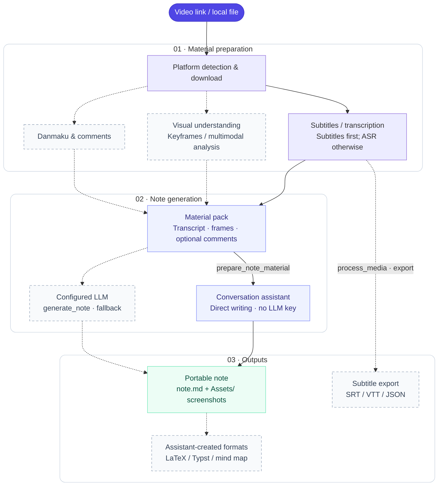
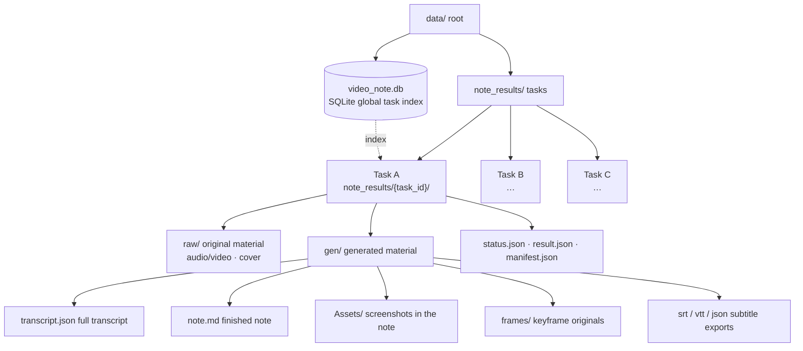

<p align="center"></p>
<h1 align="center">VideoNote-Mcp</h1>
<p align="center"><em>Video link → multi-format notes</em><br/>One link → one note · end-to-end or decoupled, any combination</p>
<p align="center"><a href="./README.md">中文</a> | <strong>English</strong></p>
<p align="center">
  <a href="#quick-start">Quick Start</a> •
  <a href="#docs">Docs</a> •
  <a href="#real-world-examples">Real-world Examples</a> •
  <a href="#pipeline-map">Pipeline Map</a> •
  <a href="#task-management">Task Management</a> •
  <a href="#best-practices">Best Practices</a> •
  <a href="#how-to-contribute">Contribute</a>
</p>

---

VideoNote-Mcp packages the whole "video link → multi-format notes" pipeline into an **MCP Server**: give it a link and it automatically runs download → transcription → frame understanding → danmaku/comments, then produces a transcript or note.

Repository: [HuangYincan/VideoNote-MCP](https://github.com/HuangYincan/VideoNote-MCP).

It works **end-to-end (one link → one note)** and is **also decoupled**: pick and choose among generation, material, task and media-processing tools. No backend required.

<p align="center">
  <a href="https://github.com/HuangYincan/VideoNote-MCP"></a>
  <a href="LICENSE"></a>
  <a></a>
  <a></a>
  <a href="https://glama.ai/mcp/servers/HuangYincan/VideoNote-MCP"></a>
</p>

---

## Quick Start

**Automatic installation: detect clients, recommend transcription, and register MCP.**

The Python installer works on Windows, Linux, and macOS. Install [uv](https://docs.astral.sh/uv/getting-started/installation/) first.

```bash
# Current source checkout (clone the repository and enter its directory first)
uv run --frozen videonote install

# Once a version containing the installer is published, use on all three systems
uvx videonote@latest install
```

> The new `install` subcommand needs a release; updating the source does not add it to previously published PyPI versions.

The terminal wizard supports Claude Code, Codex, Claude Desktop, Cursor, OpenCode, Pi, Grok Build, Gemini CLI, Kiro, VS Code, and GitHub Copilot CLI. It lists candidates detected through CLI executables or configuration by default, with a manual selection entry for other targets. Use arrow keys to move, Space to select multiple targets, Enter to confirm, and Left to cancel. Pi needs a version with native MCP support; the installer checks CLI capabilities first. Transcription and model size also use selection menus. The installer recommends MLX on compatible Apple Silicon systems, CUDA when the NVIDIA GPU and runtime libraries are ready, and CPU otherwise. Before selection, it displays the existing engine, model, device, preprocessing, diarization, configuration sources, and paths. It recognizes previous Agent registrations and legacy configuration directories, asks which profile to use when several are found, and keeps the saved model without prompting for its size again. It preserves existing transcription settings by default and offers dependency preparation and model downloads. Terminal configuration and MCP use the same runtime.

After installation, open `videonote setup` → **① Agent 客户端 → 启用的平台（多选）** to manage enabled targets. For example, uncheck Claude Code and keep Codex checked, then confirm to disable VideoNote in Claude Code. Registrations can be restored with their original settings; other MCP servers and Agent settings are preserved. This menu also installs or updates targets. **卸载 VideoNote 注册（多选）** removes selected user-level registrations and recovery archives, keeping the program, models, and notes. Changes create backups. Status indicates saved configuration; restart existing sessions or reconnect MCP. Manage plugins, project registrations, and compatibility imports inside the Agent.

```bash
# Source examples; after release, replace the prefix with uvx videonote@latest
uv run --frozen videonote install --dry-run
uv run --frozen videonote install --client codex --client cursor
uv run --frozen videonote install --yes --client codex --asr auto --download
```

`--dry-run` writes no configuration and downloads no dependencies or models. Unattended installation requires `--yes` and explicit targets. Changing an existing VideoNote registration needs confirmation or `--replace`; existing plugins and unrelated servers with the same name are preserved. Install FFmpeg separately.

**Manual registration (available in published versions):**

```bash
# 1) Register the standalone MCP server (published PyPI version)
claude mcp add --scope user videonote -- uvx videonote@latest

# 2) Configure transcription / platform login in your terminal
#    The default note workflow needs no LLM API key
uvx videonote@latest setup

# 3) Restart or reconnect MCP, then send a video link
```

For JSON-based MCP clients:

```json
{
  "mcpServers": {
    "videonote": {
      "type": "stdio",
      "command": "uvx",
      "args": ["videonote@latest"]
    }
  }
}
```

> [!NOTE]
> The default `uvx videonote@latest` only ships the base dependencies (fast-whisper + platform subtitles); **optional engines are not included**.
> To use `mlx-whisper` on the Apple GPU (macOS), pass it in **both** the MCP registration and the terminal setup (`--with` must come **before** the tool name):
>
> ```bash
> claude mcp add --scope user videonote -- uvx --with mlx-whisper videonote@latest
> uvx --with mlx-whisper videonote@latest setup
> ```
>
> For JSON clients, prepend `"--with", "mlx-whisper"` to `args`:
>
> ```json
> {
>   "mcpServers": {
>     "videonote": {
>       "type": "stdio",
>       "command": "uvx",
>       "args": ["--with", "mlx-whisper", "videonote@latest"]
>     }
>   }
> }
> ```
>
> `funasr` (best for Chinese) works the same way: use `--with funasr --with torch` instead.

> [!TIP]
> Automatic installation, manual registration, configuration, updates, and security are covered in [docs/04-使用手册.md](docs/04-使用手册.md).

## Export Formats

- **Subtitles:** SRT, VTT and JSON for preserving timestamps or importing into other tools.
- **Markdown notes:** organize the transcript, frames and comments into notes that are easy to read and edit.
- **LaTeX / Typst:** the package includes Math Note, English Article and zju-lab templates. An MCP client can list, read and copy them to a new directory.
- Template copies never overwrite an existing directory. Install the required LaTeX / Typst compiler, fonts and packages locally; MCP provides the materials and templates but does not compile PDFs automatically.

See the [user manual](docs/04-使用手册.md) for the complete export guide.

## Docs

Full installation / configuration / usage / env vars / updating / security docs now live in `docs/` (this README keeps just the overview):

- [Document Index](docs/00-文档索引.md)
- [Architecture](docs/02-架构设计.md)
- [User Manual](docs/04-使用手册.md) — install (4 methods) · config (setup wizard + CLI) · env vars · updating · security
- [Changelog](docs/CHANGELOG.md)
- [Editable architecture diagram](docs/videonote-mcp-architecture.excalidraw)

---

## Real-world Examples

Two end-to-end examples: one uses direct conversation-assisted generation to produce a **LaTeX mathnote PDF**; the other runs **fully automatic LLM generation** and produces portable Markdown.

### Example 1 · agent_direct + LaTeX mathnote (DeepSeek-V4 video)

> Source: [【闪客】深入解读 DeepSeek V1~V4！男女老少都听得懂～](https://www.bilibili.com/video/BV1rpovBCEGH/?vd_source=2a93b97e35c51587de18c73fcf753191)

One video + four kinds of external sources (paper / tech report / WeChat announcement / open-source collections) → **conversation-assisted generation** of a refined note, output as a **LaTeX mathnote PDF** (Chinese KaiTi template):

| Page1 | Page2 | Page3 |
| :---: | :---: | :---: |
|  |  |  |

- No LLM key: the note is organized from the transcript, frames and comments
- Multi-source cross-integration: video × paper × tech report × open-source list
- Refined copy keeps the original: `note.md` / `note_original.md` pair
- LaTeX mathnote PDF: auto-fixes missing fonts / line-overflow / citation dedup

Full run record: [`examples/agent-direct-deepseek-v4-mathnote/README.md`](examples/agent-direct-deepseek-v4-mathnote/README.md).

### Example 2 · Fully automatic LLM generation + portable Markdown (multi-video parallel)

A minimal prompt (3 Bilibili links + an output dir, not a single parameter given) → **fully automatic** run of env check → link detection → provider/model discovery → parameter confirmation → multi-video parallel → post-generation refinement from the transcript, producing 3 **portable refined notes** (`note.md` + `Assets/` screenshots + a "Viewer Opinions" section, keeping `note_original.md` for comparison).

- [**IELTS**](https://www.bilibili.com/video/BV1c54y187SH/): myth-busting + listening/reading/writing/speaking breakdown + 179 high-frequency exam words + 15-sentence logic framework
- [**Forensics**](https://www.bilibili.com/video/BV1QEgZ6rEGj/): a 43-year forensic pathologist "reacts" to film vs. reality; refined into 12 sections
- [**Transformer**](https://www.bilibili.com/video/BV1r8nMz4EAj/): self-attention deep dive, 18 screenshots distributed along the lecture timeline

Full run record: [`examples/note-generation-example/README.md`](examples/note-generation-example/README.md).

---

## Pipeline Map



Solid lines show the default flow: `prepare_note_material` prepares the pack, and the conversation assistant organizes the note. Dashed lines show optional capabilities or fallback paths: use `generate_note` with the configured LLM when the assistant cannot view images or the user requests it. Subtitles can be exported independently; the assistant creates other formats on demand. Stage details live in [docs/02-架构设计.md](docs/02-架构设计.md).

## Task Management

One folder per task `note_results/{task_id}/`: `raw/` (downloaded media) + `gen/` (transcript/note/frames/exports) + control files; a **global task index** lives in the SQLite `video_tasks` table (with semantic titles). `list_tasks` enumerates all tasks (identify by semantic title), `cleanup(task_id, dry_run=True)` inspects a task before cleanup, `cleanup` does per-task / global cleanup (config & models kept by default), and `health_check` verifies FFmpeg / database / whisper readiness.



| Tool | Description | Type |
|------|------|------|
| `list_tasks` | List all tasks (global index, with semantic titles) | MCP tool |
| `cleanup` | Per-task cleanup (with `task_id`) / global cleanup (factory reset, without) | MCP tool |
| `health_check` | FFmpeg / database / whisper readiness | MCP tool |

---

## Best Practices

- **Study & exam prep**: end-to-end + video understanding + transcript-based follow-up refinement.
- **Meeting minutes**: `process_media(action="merge")` to join recorded segments → `process_media(action="diarize")` for speakers → `meeting_minutes` style.
- **Deep-reading a lecture**: after end-to-end generation, refine from the full transcript, filling in section by section.
- **Video appreciation**: enable danmaku + comment integration for an "Audience viewpoints" section.
- **Default path**: one link uses `prepare_note_material`, and the conversation assistant organizes the note; use `generate_note` when image understanding requires the configured LLM or the user asks for it. Use `process_media` for media operations (merge / diarize / export).
- **Real example**: full run records for both cases live in [`examples`](examples).

## How to Contribute

Issues, improvement ideas and pull requests are welcome. See [CONTRIBUTING.md](CONTRIBUTING.md) for the development environment, tests, branch policy and code navigation.

## Acknowledgements

Thanks to the community and all contributors, to [Glama](https://glama.ai) for listing this MCP server, and to all open-source dependencies and the upstream pipeline project that inspired this work.
